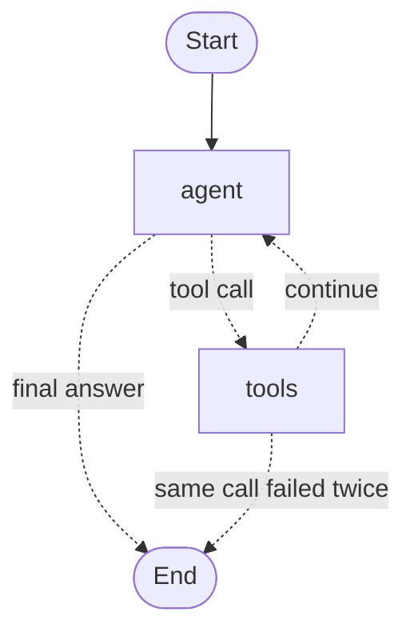

# Mini Data Science Assistant

An agentic data science assistant. Upload a CSV, optionally with a
document describing it, ask a question in plain English, and a local LLM
decides which tools to run, chains them together, and explains the result.

Everything runs locally. No API keys, no cloud inference.

## What it does

```
"What was the average opening price during the first 10 days of January 2025?"

→ filter_data         : Date between 2025-01-01 and 2025-01-10  → 6 rows
→ calculate_statistic : mean of Open on those 6 rows            → 65.3733
→ "The average opening price during the first 10 days of
   January 2025 was 65.3733."
```

When the question is about meaning, the agent reads the dataset's own
description first:

```
"What does Adj Close mean, and what was its average value in 2024?"

→ search_context      : passages from uber_stock_data.md        → Adj Close, Close, Daily return
→ filter_data         : Date year_is 2024                        → 252 rows
→ calculate_statistic : mean of Adj Close on those 252 rows      → 70.7668
→ "Adj Close is the adjusted closing price [...]. Its average
   value in 2024 was 70.7668."
```

The model plans the steps. It does not compute anything itself.

## Architecture

```
User question
      ↓
   Gemma 8B              understand + plan
      ↓
  MCP tools              expose capabilities
   ↙        ↘
Pandas    RAG search     compute on the data / read the dataset's description
   ↘        ↙
   Gemma 8B              synthesize
      ↓
   Answer
```

Three separate responsibilities:

| Layer  | Role |
|--------|------|
| Gemma  | Interprets intent, selects tools, writes the final answer |
| MCP    | Exposes small, composable data capabilities |
| Pandas | Performs every actual computation |
| RAG    | Retrieves passages from the dataset's description document |

## Tool chaining

The hard part is passing a result from one tool to the next without
writing temporary files.

When a tool produces a table, it keeps the DataFrame in a server-side
registry and returns a short handle (`ds:a1b2c3`). The next tool accepts
that handle as its `source` argument instead of a file path.

```python
filter_data(source="data.csv", ...)     → ds:a1b2c3, 6 rows
calculate_statistic(source="ds:a1b2c3", column="Open", statistic="mean")
```

Two consequences:

- The model never receives the rows. It gets a count, the column names,
  and the handle. A 437-row filter costs the same context as a 6-row one.
- The registry lives inside a single MCP session, which lasts exactly one
  user question. Nothing to clean up, no cross-question leakage.

Chains are not limited to two steps:

```
"What was the average opening price during the first 10 days
 of each month in 2024?"

→ filter_data         year_is 2024   → 252 rows, ds:...
→ filter_data         day_is 1,10    → 83 rows,  ds:...
→ calculate_statistic mean of Open   → 70.2163 on 83 values
```

## MCP tools

| Tool | Purpose |
|------|---------|
| `get_dataset_info` | Rows, columns, missing values, duplicates |
| `calculate_statistic` | mean, median, min, max on a numerical column |
| `filter_data` | Filter rows by condition, date range, or date component |
| `group_by` | Group and aggregate, with optional time period |
| `detect_missing_values` | Per-column missing value report |
| `detect_outliers` | Outlier detection by IQR or z-score |
| `correlation_analysis` | Correlation between two columns, or the strongest pairs |
| `search_context` | Passages from the dataset's description: column meanings, units, context |

### Date handling

Date columns are detected by content, not by name: a column is treated as
dates when over 90% of its values parse as such. A column called
`trade_date` or `order_dt` works without configuration.

Beyond ranges, `filter_data` supports date component operators:

```
year_is   2024        every row in 2024
month_is  6           every June, across all years
day_is    1,10        the first 10 days of every month
```

Column names are resolved case-insensitively, so `open`, `Open` and
`OPEN` all reach the same column.

### Result envelope

Every tool returns the same shape:

```json
{
  "success": true,
  "summary": "6 rows matched Date between 2025-01-01 and 2025-01-10. To analyse them further, call another tool with source=\"ds:a1b2c3\".",
  "rows": [],
  "columns": [],
  "count": 6
}
```

The `summary` field is what the model reads. The rest is for the UI.

## Dataset descriptions (RAG)

A dataset can come with a description document. It lives next to the CSV,
with the same name:

```
uber_stock_data.csv      the data
uber_stock_data.md       its description (.md or .txt, optional)
uber_stock_data.rag/     its index, generated
```

Knowledge belongs to the dataset, not to the application. Two datasets
never share passages, and a dataset without a description still works:
`search_context` says so and the agent answers from the data alone.

`rag.py` does the retrieval in four steps:

1. **Chunk**: one chunk per `## ` section. Documents without headings are
   split into groups of whole paragraphs of about 800 characters.
2. **Embed**: every chunk goes through `nomic-embed-text` (Ollama), with
   `search_document:` / `search_query:` prefixes. Vectors are normalized,
   so cosine similarity is a plain dot product.
3. **Store**: `vectors.npy` and `chunks.json` in `<name>.rag/`. The MCP
   server starts a new process for every question, so the index is built
   once and only loaded at query time.
4. **Search**: the question is embedded and the 3 closest chunks come back,
   best first. Gemma receives their full text and answers from it.

An index refuses to load when its description has changed since it was
built:

```bash
python rag.py build uber_stock_data.csv
python rag.py search uber_stock_data.csv "What is the difference between Close and Adj Close?"
```

`search_context` is an ordinary MCP tool, so the agent graph did not change.
Gemma decides when a question needs the description, the same way it
decides when it needs a filter.

`test_rag.py` covers chunking, naming, the guard rails, and a small
evaluation set: each question must find its passage in the top 3.

## Agent loop

The agent is a LangGraph state graph, defined in `agent_graph.py`.



- **State**: the conversation, a step counter, the execution trace, the
  last table, error tracking and the final answer. Lists (`messages`,
  `steps`) use an append reducer; every other field is replaced.
- **`agent` node**: calls Gemma with the conversation and the MCP tools.
  On the 5th step tools are withheld, forcing a text answer.
- **`tools` node**: runs the requested MCP tool and appends its summary
  to the conversation.
- **Routing**: nodes write `final_answer`; routing functions only read
  it to decide whether to stop.

One MCP session per question. The graph is built inside that session and
its nodes reach it through a closure, so every tool call in a question
hits the same server process and the same dataset registry. That is what
keeps `ds:` handles valid from one tool to the next. MCP adapters that
open a new session per tool call would break this, so the graph calls
`session.call_tool()` directly.

The hand-written loop it replaced is in the git history (`989df578`).

## Stack

- **Gradio** — web interface
- **Ollama + Gemma 8B** (`gemma4:e4b`, Q4_K_M) — local reasoning
- **MCP** (`mcp==1.29.1`, FastMCP) — tool protocol
- **Pandas** — data operations
- **Whisper** (`openai/whisper-small`) — local voice input
- **Matplotlib** — histograms
- **LangGraph** — agent orchestration as a state graph
- **nomic-embed-text** (Ollama) — embeddings for retrieval
- **NumPy** — vector search

## Running locally

Requires [Ollama](https://ollama.com) with both models pulled:

```bash
ollama pull gemma4:e4b
ollama pull nomic-embed-text
```

Then:

```bash
python -m venv .venv
source .venv/bin/activate
pip install -r requirements.txt
python app.py
```

The app opens on `http://localhost:7860`. Upload a CSV and ask away.

To try the description search, put `uber_stock_data.csv` next to the example
description `uber_stock_data.md` (the CSV itself is not in the repository),
then build its index:

```bash
python rag.py build uber_stock_data.csv
python test_agent_graph.py
```

The web interface does not accept a description upload yet: see the roadmap.

## Project files

```
app.py               Gradio interface
agent_graph.py       LangGraph agent: state, nodes, routing, entry point
mcp_server.py        MCP server, tools, dataset registry
rag.py               Chunking, embeddings, index and search over descriptions
mcp_client.py        Async wrappers for direct tool calls
uber_stock_data.md   Example description document
test_mcp.py          Tool tests without the LLM
test_rag.py          Retrieval tests and evaluation set
test_agent_graph.py  End-to-end agent test, data and description questions
llm_mcp_test.py      LLM + MCP integration test
```

## Roadmap

- [x] MCP tools for statistics, filtering, grouping
- [x] Tool calling with a local model
- [x] Multi-step agent loop
- [x] Tool chaining through dataset handles
- [x] More tools: outliers, correlations, missing values
- [x] Agent rebuilt as a LangGraph state graph
- [x] RAG over each dataset's own description document
- [ ] Description upload in the web interface
- [ ] Deployment on a self-hosted VPS

## License

MIT